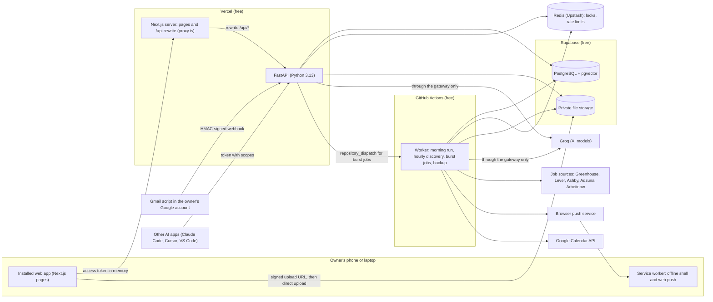
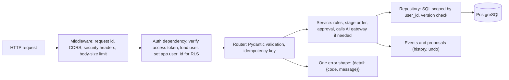
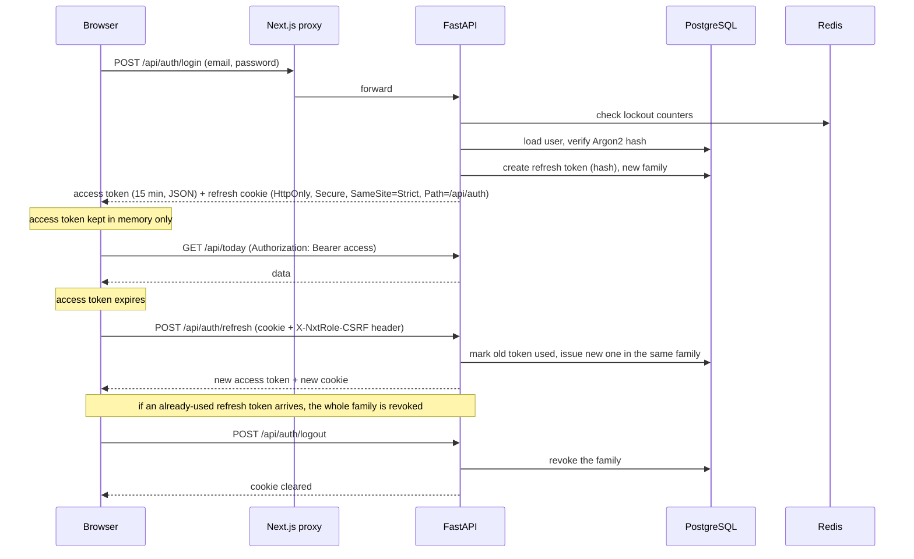
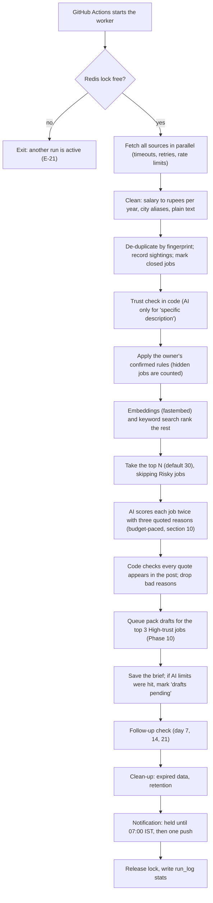
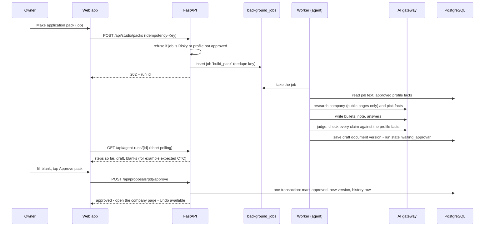
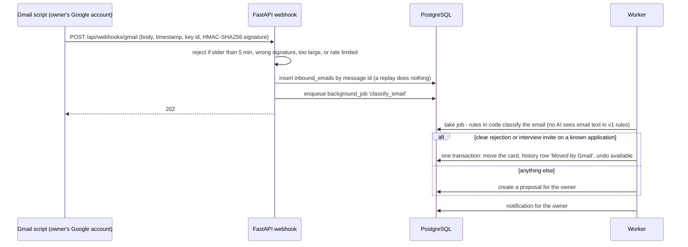
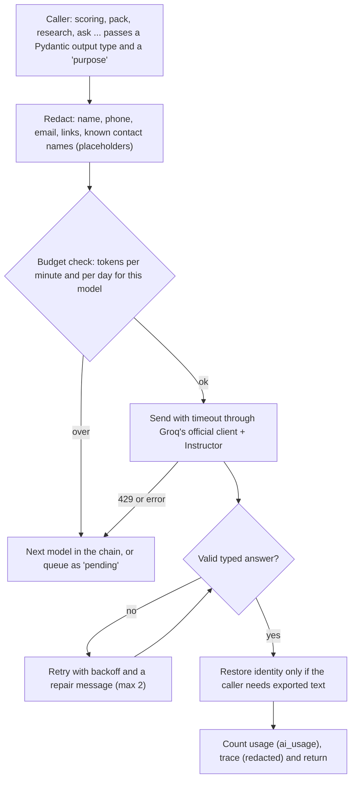
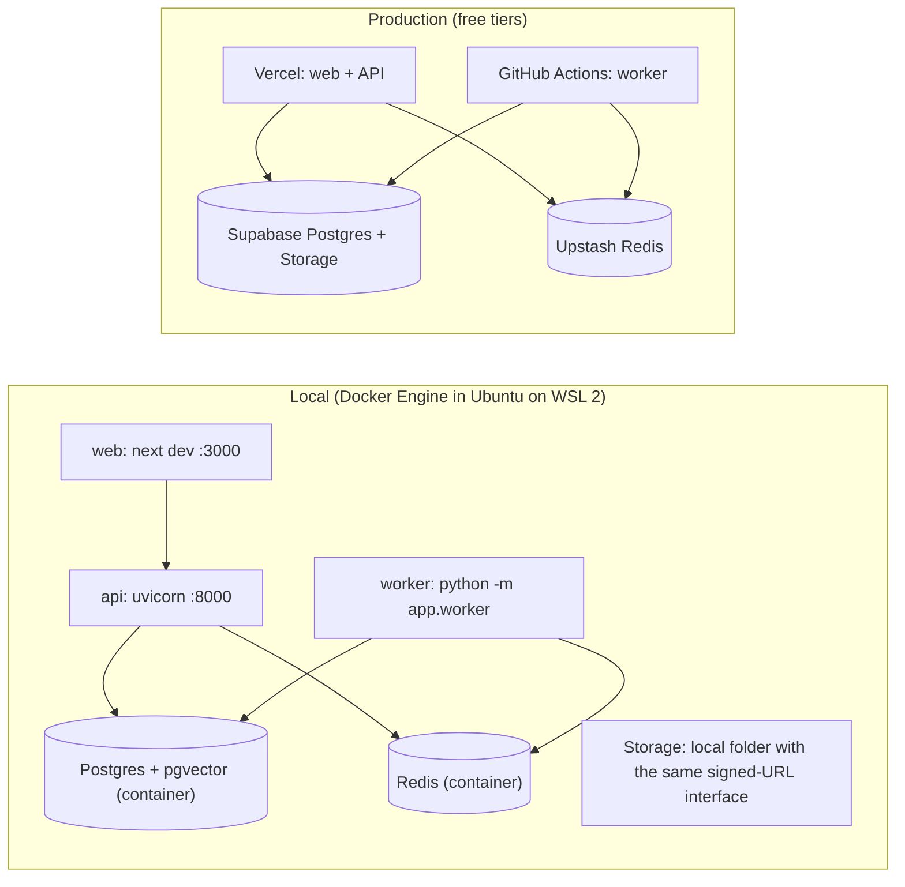
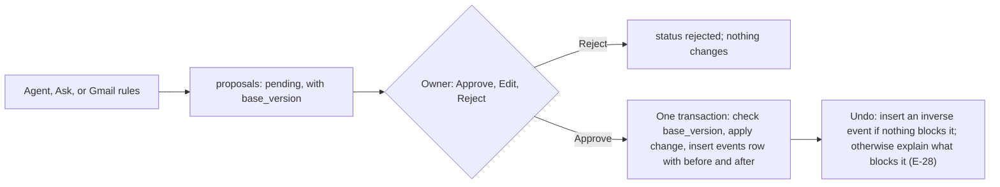

# Architecture

Status: **Phase 1 design, 27 Nov 2026.** Inputs: `docs/PRD.md`, `docs/DECISIONS.md` (D-001 to D-040), `docs/TECH_STACK.md`, `docs/DATABASE_SCHEMA.md`.
Nothing here is built yet. Phase 2 creates the repository structure in section 3; later phases fill it in.

## 1. Overview and principles

NxtRole is two programs and a set of scheduled jobs that share one database:

- **`web/`** is the screens (Next.js, TypeScript). It is installed on the phone as a web app.
- **`api/`** is the brain and the data gate (FastAPI, Python). It checks every request, talks to the database, and calls AI only through one gateway.
- **The worker** is the same Python code run in the background (locally in a terminal, in production by GitHub Actions). It does slow work: searching jobs, scoring, drafting, researching.

Principles that every design choice follows:

1. **The database is the memory.** Slow work is a row in `background_jobs`; progress and results are rows. A closed tab or a restarted server loses nothing (D-026, D-038).
2. **AI never writes to the database directly.** It creates a **proposal**. The owner approves it. One transaction applies it, writes a history row, and can be undone (section 12.2).
3. **One door for AI.** Every model call goes through `api/app/ai/gateway.py`, which removes identity first (D-025).
4. **Every query is scoped to the owner** in code *and* by PostgreSQL row-level security (D-028, D-039).
5. **Short requests.** The API assumes it has 10 seconds per request (D-038).
6. **Free tiers.** Nothing that costs money; every limit is a design input (`docs/TECH_STACK.md` section 5).

## 2. System diagram and components



| Component | Responsibility | Does **not** do | Built in |
|---|---|---|---|
| Next.js pages | Screens, forms, loading and error states, holds the access token in memory | Talk to the database or to AI; hold secrets | 3 and each phase |
| Next.js `proxy.ts` | Rewrites `/api/*` to FastAPI so the browser sees one origin; sets security headers | Decide who is signed in (the API does; the proxy is not the only guard) | 3 |
| FastAPI routers | Validate input (Pydantic), check auth, call a service, shape the answer and errors | Contain business rules or SQL | 4 and each phase |
| Services | Business rules: stage order, approval, scoring, trust, estimates | Know about HTTP | each phase |
| Repositories | All SQL, always scoped to the user, optimistic-lock checks | Business decisions | each phase |
| AI gateway | Removes identity, walks the model chain, retries, counts usage, validates answers, restores identity | Decide anything about the owner's data | 5 |
| Worker | Takes `background_jobs`, runs handlers, schedules the daily work | Serve web requests | 8 |
| Agents (LangGraph) | Multi-step tasks (pack, research, ask) that pause for approval; state saved in PostgreSQL | Write data except as proposals | 10 and 11 |
| MCP server | Read tools for other AI apps, one draft-note tool, token scopes | Send, delete, change settings, read email text | 11 |
| Gmail script | Posts job emails to the webhook with an HMAC signature | Run anywhere but the owner's Google account | 12 |
| Service worker | Caches the shell for offline reading, receives web push | Queue changes silently (E-33) | 8 |

## 3. Repository structure

Created in Phase 2: everything below marked with its phase already exists only if the phase is 2; the rest is added by the phase that needs it.

```
NxtRole/
├── web/                         Next.js app (TypeScript strict)                              (Phase 2)
│   ├── src/app/                 Routes: (public) landing, login, legal; (app) today, jobs, ...
│   ├── src/components/ui/       Radix-based parts styled to the mocks (D-048)               (Phase 3)
│   ├── src/features/<domain>/   Screen parts, hooks and zod schemas per domain (health: Phase 2)
│   ├── src/lib/                 api client, auth (token in memory), config, format (IST, LPA)
│   ├── src/styles/tokens.css    Copy of docs/mocks/design-tokens.css                         (Phase 2)
│   ├── public/                  Icons, manifest, service worker
│   ├── e2e/                     Playwright journeys, visual and accessibility checks         (Phase 2, D-044)
│   ├── next.config.ts           /api forwarding and basic security headers                   (Phase 2)
│   └── src/proxy.ts             Nonce-based content security policy                          (Phase 3, D-043)
├── api/
│   ├── app/
│   │   ├── main.py, serve.py    Creates the app; starts it locally                           (Phase 2)
│   │   ├── config.py            The one configuration module (environment variables only)    (Phase 2)
│   │   ├── core/                errors, logging (redaction), middleware, redis, event loop   (Phase 2);
│   │   │                        security (Argon2, JWT), idempotency, time (IST), rate limits
│   │   ├── db/                  engine, sessions, base model (Phase 2); RLS setup, models/
│   │   ├── ai/                  gateway.py, redaction.py, prompts/, schemas/, budget.py, evals/
│   │   ├── <domain>/            router.py, service.py, repository.py, schemas.py (health: Phase 2)
│   │   ├── worker/              loop.py, schedules.py, handlers/<kind>.py
│   │   └── cli.py               check-config (Phase 2); create-owner, reset-password, run-job
│   ├── migrations/              Alembic versions (0001: the vector extension)                (Phase 2)
│   └── tests/                   unit/, integration/ (real Postgres and Redis), contract/
├── tests/fixtures/              Recorded real responses, name = source_YYYY-MM-DD_what.json
├── docker-compose.yml           Local Postgres+pgvector and Redis                            (Phase 2)
├── docker/postgres/init/        Creates the separate test database                           (Phase 2)
├── .github/                     workflows/ci.yml, dependabot.yml (Phase 2); morning, discovery, burst, backup
├── scripts/                     new-local-env.ps1, install-docker-ubuntu.sh                  (Phase 2)
├── docs/                        This documentation set
├── CLAUDE.md  README.md  .env.example (root, api, web)  .gitignore  .pre-commit-config.yaml  .nvmrc
```

**Domains (one package each under `api/app/`)**: `auth`, `accounts`, `files`, `profile`, `preferences`, `sources`, `companies`, `jobs`, `trust`, `matching`, `rules`, `today`
(brief), `alerts`, `pipeline` (applications, rounds, notes), `followups`, `offers`, `coach`, `studio` (documents, packs), `agents`, `resume`, `prepare`, `ask`, `network`,
`mcp`, `integrations` (gmail, calendar), `settings`, `proposals`, `history`, `health`.

## 4. Request layers



Rules: routers never run SQL; repositories never apply business rules; services never read the HTTP request; every error becomes
`{"detail": {"code": "...", "message": "..."}}` with a message in plain words (NFR-SEC-01).

## 5. Sign-in, token refresh and logout



Two tabs: the browser app takes a **single-flight lock** (the Web Locks API, with a `BroadcastChannel` fallback) so that only one tab calls refresh and the other tabs wait for its result (E-23). Recovery by code
(`/login/recover`, D-027) uses the same token machinery and revokes all sessions.

## 6. The morning run

Starts at **00:00 UTC (05:30 IST)** (D-030) and must finish before 07:00 IST. Push is sent at or after 07:00 IST.



If the run fails, Today shows the previous brief with a "stale" label and one push says so (E-22).

## 7. Application pack agent (pause, approve, resume)



The agent's graph state is saved in the PostgreSQL checkpointer after every step, so a closed tab or a restart resumes the same run (E-44). Only tools allowed for
that agent are given to it; text from the web or the job post is passed as data (NFR-SEC-06).

## 8. Gmail webhook



The script sends only emails that match the job filter, and the server stores only the minimal fields (D-019, D-035). The email text is processed in memory and not stored or logged.

## 9. Background work and the free scheduler budget

**Queue.** `background_jobs` rows, taken with `select … for update skip locked`, with `run_after` for backoff, a dedupe key, and stale-lock reclaim (D-026).
**Locks and limits.** Redis keys with expiry: `lock:morning:{user}`, `lock:discovery`, per-provider rate counters. Redis down → the worker refuses to run scheduled work
(safe) and the API falls back to database-based rate limits for sign-in only (E: Redis down).
**Where the worker runs.** Locally: a terminal command. Production: GitHub Actions. Burst work started by the owner (a pack, research, an export) is launched by the API
with a `repository_dispatch` call (a fine-grained GitHub token limited to this repository's Actions, kept in Vercel's environment). Phase 15 measures whether Vercel
functions can run short steps inline; if so the burst start-up cost disappears (D-038).

| Workflow | Schedule (UTC) | IST | Notes |
|---|---|---|---|
| `morning.yml` | `0 0 * * *` | 05:30 | Section 6. Up to 15 minutes |
| `discovery.yml` | `30 1-15 * * *` | 07:00 to 21:00 hourly | 15 runs; the 07:00 run sends the morning push; also retries "Drafts pending"; light, cached dependencies |
| `burst.yml` | `repository_dispatch` | on demand | Packs, research, export, delete, calendar sync |
| `backup.yml` | `30 20 * * *` | 02:00 | Dump, upload to private storage, check |
| `security.yml` | weekly | Sunday | Dependency audit and secret scan |

**Estimated budget (private repository, 2,000 free Linux minutes a month, billed in whole minutes per job).** These are **estimates to be measured in Phases 8 and 15** (D-040).

| Item | Runs a month | Minutes each | Minutes |
|---|---|---|---|
| Morning run | 30 | 15 | 450 |
| Discovery (hourly, 07:00 to 21:00 IST, 15 a day) | 450 | 2 | 900 |
| Backup | 30 | 3 | 90 |
| Burst runs (about 2 a day on demand) | 60 | 3 | 180 |
| Weekly security job | 4 | 5 | 20 |
| **Total** | | | **1,640 (82%)** |

Levers if usage nears the limit, in this order: discovery every 2 hours (about 450 minutes saved); fewer top-N jobs; run bursts inline (if Phase 15 allows); make the
repository public (code is not secret; secrets live only in encrypted settings) for unlimited standard-runner minutes. Settings > Agents shows the month's estimated minutes (from `run_logs`).
Scheduled runs can start late (GitHub documents delay under load), so every run is idempotent and `health` reports "last run too old" (NFR-REL-02).

**Keeping the free database awake.** The hourly run touches the database, so the 7-day pause rule never triggers while the schedule works (E-21).

## 10. AI gateway (D-025, D-033)



- **Model chain** is configuration: a primary large model, then other free Groq models (each has its own allowance), then "pending". Exact names are read from Groq's console in Phase 5.
- **Pacing.** gpt-oss-120b allows about 8,000 tokens a minute and 200,000 a day. The gateway spaces calls and keeps a per-day token counter in Redis and in `ai_usage`; the morning run's 60 scoring calls (about 2,000 tokens each) take about 15 minutes on one model, which is why the morning run starts early and splits the two passes over two models.
- **Purposes.** Each call states a purpose (`score`, `judge`, `pack_write`, `research`, `ask`, `coach_wording`, `trust_description`, …). Purposes decide the model, the schema and what may be sent. Personal data
  (contacts, email text, offer-letter identity) is rejected by the redactor for purposes that must not carry it.
- **Prompt-injection stance.** Untrusted text sits in a delimited data block, never in the instruction part; outputs are schema-validated; quotes are verified in code; tools are least-privilege.
- **Tests.** The gateway is unit-tested with recorded Groq responses (real, dated fixtures) and a fake that returns 429s, malformed JSON and slow answers.

## 11. Local and production



| Concern | Local | Production |
|---|---|---|
| Database | Container, same major version and `vector` extension | Supabase; Data API **off**; connection through the pooler for the API, direct for migrations |
| Files | Local folder behind the same storage interface | Supabase private bucket with signed URLs |
| Worker | `uv run python -m app.worker` | GitHub Actions workflows |
| Config | `.env` files filled in by the owner (templates in `.env.example`) | Vercel environment and GitHub secrets (D-020) |
| Secrets | Never committed; `check-config` lists what is missing | Same |
| Domain | `localhost` | `*.vercel.app` over HTTPS |

## 12. Cross-cutting design

### 12.1 Errors, validation and idempotency
One error shape; every input validated by Pydantic on the server and zod in forms; create endpoints accept an `Idempotency-Key` and store the response for 24 hours; updates send
`version` (or `If-Match`) and get `409 conflict` on mismatch (E-27).

### 12.2 Proposals, history and undo

The single exception (D-004): rules in code may apply a "clear rejection" or "clear interview invite" move directly, still through the same transaction, event row and undo.

### 12.3 Time, money and language
Stored in UTC and rupees; shown in IST with the zone named for other zones; LPA for yearly pay; English only in v1.

### 12.4 Observability
`structlog` JSON logs with a request id and a redaction filter; `run_logs` for scheduled runs; the in-app agent log reads `agent_runs` and `events`; Sentry and Langfuse are optional and receive redacted data only (NFR-OBS).

### 12.5 Configuration
One module `api/app/config.py` reads environment variables with Pydantic settings, fails at start-up with a clear message listing missing names, and exposes `check-config`.
`.env.example` lists every variable with no values. The web app reads only `NEXT_PUBLIC_*` values that are safe in a browser.

### 12.6 Offline and install
The service worker caches the shell and the last loaded read-only screens, shows an offline notice, disables actions, and never queues changes silently (E-33). A web manifest makes it installable; the same worker
receives web push (VAPID keys generated locally by the owner, D-020).

### 12.7 Performance
Today is built before the owner opens the app (the brief is a stored row), so the screen is one small read. Lists are cursor-paginated. Heavy pages (landing 3D, charts) load lazily. Target: Today under 2 seconds on a phone (NFR-PERF-01).
