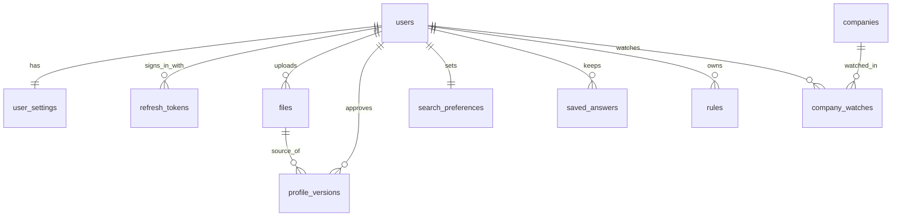
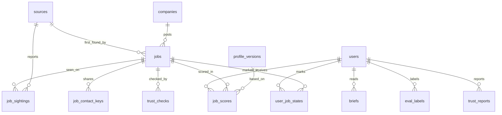
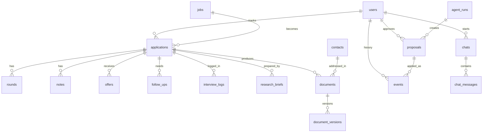
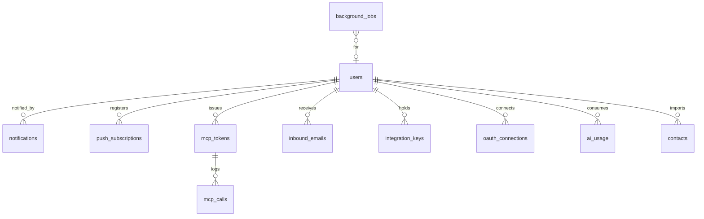

# Database schema

Status: **Phase 1 design, 27 Nov 2026.** Engine: PostgreSQL with the `pgvector` extension. Access: SQLAlchemy 2 (typed), migrations with Alembic.
Inputs: `docs/PRD.md` (data needs per screen, FR-001 to FR-220, Appendix B data classes), decisions D-003, D-026, D-028, D-029, D-034, D-035, D-039.
Nothing here is built yet; Phase 4 creates the base tables and each later phase adds its own through migrations.

## 1. Reading guide

**Conventions (apply to every table unless a row says otherwise)**

| Convention | Rule |
|---|---|
| Names | `snake_case`, plural table names, singular column names. |
| Primary key | `id uuid primary key default gen_random_uuid()`. Exceptions are listed (composite keys). |
| Time | `timestamptz` in UTC. Screens convert to IST. Columns `created_at timestamptz not null default now()` on every table; `updated_at` where marked **(U)**. |
| Money | Whole rupees in `bigint` (INR per year unless the name says otherwise). No fractions, no floats. Original text kept beside the number. |
| Enumerations | `text` with a `check` constraint (easier to change in a migration than a PostgreSQL enum). Allowed values are listed. |
| Concurrency | Tables marked **(V)** have `version int not null default 1`. An update must send the version it read; a mismatch returns HTTP 409 (E-27). |
| Per-user tables | `user_id uuid not null references users(id) on delete cascade`, an index starting with `user_id`, and row-level security (section 6). Marked **[user]**. |
| Global tables | Shared by all users, contain **nothing personal**. Marked **[global]**. |
| Text from outside | Job text, email text and AI text are stored as plain text, never as HTML (NFR-SEC-04). |
| Deleting | "Delete my account and data" is one `delete from users` that cascades to every **[user]** table. Files in storage are removed by the same job. |
| Sizes | The free database is 500 MB (`docs/TECH_STACK.md` section 5). Large text is capped (job text 20,000 characters, resume text 30,000, note 10,000). |

**Why a global and a per-user side** (D-028). A job posted by a company is the same fact for everybody, so it is stored once. What the owner thinks of it
(score, saved, skipped, notes, application) belongs to the owner. This keeps personal data in tables that can be exported and deleted in one pass, and makes
inviting users later a small step (D-003). Jobs added by hand or from the owner's emails carry `added_by_user_id`; a query returns a job if it is shared
(`added_by_user_id is null`) or the user's own.

## 2. Entity diagrams

### 2.1 Identity, profile and rules

### 2.2 Jobs, trust and matching

### 2.3 Pipeline, drafts and approvals

### 2.4 Operations and integrations

## 3. Global tables **[global]**

### sources
Where jobs come from (one row per adapter). Seeded by a migration with the **configuration** of real sources (names and kinds only, no job data), never sample jobs.
| Column | Type | Null / default | Notes |
|---|---|---|---|
| kind | text | not null | `greenhouse`, `lever`, `ashby`, `adzuna`, `arbeitnow`, `email_alert`, `manual` |
| name | text | not null, unique | Display name |
| status | text | not null default `ok` | `ok`, `paused`, `error` |
| last_run_at, last_ok_at | timestamptz | null | |
| last_error | text | null | Short, never a secret |
| next_retry_at | timestamptz | null | Shown in the "Source paused" banner |
| rate_limit | jsonb | not null default `{}` | Requests per minute, daily cap |

### companies
| Column | Type | Null / default | Notes |
|---|---|---|---|
| name | text | not null | As shown |
| normalized_name | text | not null, unique | Lower case, punctuation and "pvt ltd" stripped; used to merge duplicates |
| domain | text | null | Official domain (used by the trust check "contact matches the company") |
| careers_url | text | null | Public https only |
| feed_kind | text | null | `greenhouse`, `lever`, `ashby`, or null ("No public feed") |
| feed_token | text | null | Board token or slug for that feed |
| is_it_services | boolean | null | Set by rules, used by rule suggestions |
Index: `unique(normalized_name)`.

### jobs
| Column | Type | Null / default | Notes |
|---|---|---|---|
| company_id | uuid | not null → companies | |
| source_id | uuid | not null → sources | First source that reported it |
| external_id | text | not null | Id on that source |
| added_by_user_id | uuid | null → users, on delete cascade | Null = shared; set = added by that user (by hand or from their email) |
| title | text | not null | |
| normalized_title | text | not null | For matching and de-duplication |
| description_text | text | not null | Plain text, capped at 20,000 characters |
| snapshot_text | text | null | Copy kept in case the posting is taken down (FR-042) |
| url | text | not null | Page on the source |
| apply_url | text | null | The company's own application page |
| location_raw | text | null | |
| city | text | null | Normalised (Bangalore = Bengaluru) |
| state | text | null | |
| country | text | not null default `IN` | v1 stores only India and remote (D-006); the column stays for later |
| remote_type | text | not null default `onsite` | `onsite`, `hybrid`, `remote` |
| salary_text | text | null | Original wording, never altered |
| salary_min_inr, salary_max_inr | bigint | null | Per year; null = "Not stated" |
| salary_currency | text | null | Original currency if not INR |
| experience_min, experience_max | smallint | null | Years |
| notice_requirement | text | null | For example "immediate joiners only" |
| posted_at | timestamptz | null | Missing dates are left null (E: missing posted date) |
| first_seen_at, last_seen_at | timestamptz | not null | |
| closed_at | timestamptz | null | Set when a source stops listing it |
| content_hash | text | not null | Hash of normalised text, detects edits |
| fingerprint | text | not null | Hash of company + normalised title + city; detects the same job on other sources |
| repost_count | int | not null default 0 | |
| found_in_email | boolean | not null default false | "Found only in one forwarded alert email" signal |
| embedding | vector(384) | null | fastembed `bge-small-en-v1.5` (D-034) |
| search | tsvector | generated | From title and description, English config |
Indexes: `unique(source_id, external_id)`; `(fingerprint)`; `(company_id, posted_at desc)`; `(posted_at desc) where closed_at is null`; `gin(search)`; `hnsw(embedding vector_cosine_ops)`; `(added_by_user_id)`.

### job_sightings
The same job seen on another source, or seen again after a repost (FR-044).
| Column | Type | Null / default | Notes |
|---|---|---|---|
| job_id | uuid | not null → jobs | |
| source_id | uuid | not null → sources | |
| external_id | text | not null | |
| url | text | null | |
| seen_at | timestamptz | not null default now() | |
Index: `unique(source_id, external_id)`, `(job_id)`.

### job_contact_keys
Used to hide a scam and its siblings ("Hidden, with 2 posts that use the same WhatsApp number").
| Column | Type | Null / default | Notes |
|---|---|---|---|
| job_id | uuid | not null → jobs | |
| kind | text | not null | `whatsapp`, `phone`, `email`, `domain` |
| value_hash | text | not null | Hash of the normalised value; the raw number is not stored here |
Index: `(kind, value_hash)`, `(job_id)`.

### trust_checks
| Column | Type | Null / default | Notes |
|---|---|---|---|
| job_id | uuid | not null → jobs | |
| rules_version | text | not null | The version of the rule set that ran |
| level | text | not null | `high`, `check`, `risky` |
| signals | jsonb | not null | List of `{rule, passed, label, evidence_quote, evidence_fact}` (FR-055) |
| ai_signal | jsonb | null | Only the "specific description" signal, only if not risky (FR-054) |
| checked_at | timestamptz | not null default now() | |
Index: `unique(job_id, rules_version)`.

### tax_tables
| Column | Type | Null / default | Notes |
|---|---|---|---|
| financial_year | text | not null | `2026-27` |
| regime | text | not null | `new`, `old` |
| data | jsonb | not null | Slabs, standard deduction, cess, professional-tax by state, PF caps |
| source_note | text | not null | Where the numbers came from and the date |
Index: `unique(financial_year, regime)`. Updated by a migration each year (FR-116).

### run_logs
What each scheduled run read, matched and failed (NFR-OBS-01).
| Column | Type | Null / default | Notes |
|---|---|---|---|
| kind | text | not null | `morning`, `discovery`, `followups`, `radar`, `cleanup`, `backup` |
| user_id | uuid | null → users, on delete cascade | Null for global runs |
| started_at, finished_at | timestamptz | started not null | |
| status | text | not null | `running`, `ok`, `partial`, `failed` |
| stats | jsonb | not null default `{}` | Counts: read, matched, scored, errors |
| errors | jsonb | not null default `[]` | Short messages; no personal data |
Index: `(kind, started_at desc)`.

## 4. Per-user tables **[user]**

### 4.1 Identity and settings

**users**
| Column | Type | Null / default | Notes |
|---|---|---|---|
| email | citext | not null, unique | |
| password_hash | text | not null | Argon2id string |
| recovery_code_hash | text | not null | Argon2id of the one-time recovery code (D-027) |
| display_name | text | null | Used only in screens, never sent to AI |
| is_active | boolean | not null default true | |
| failed_logins, locked_until | int, timestamptz | default 0, null | Backed by Redis counters; this is the durable copy |
(U). No public sign-up route creates rows (D-027).

**user_settings** (one row per user; PK = `user_id`) (U)
| Column | Type | Notes |
|---|---|---|
| brief_time | time default `07:00` | IST |
| quiet_start, quiet_end | time default `22:00`, `07:00` | D-013 |
| alert_min_score | smallint default 80 | |
| alert_daily_cap | smallint default 5 | |
| alerts_enabled | boolean default true | |
| agents | jsonb | Switches: discovery, radar, inbox, research, followup (FR-196) |
| safety_rules | jsonb | Per trust rule: `hide` or `warn` (FR-060) |
| ai_queue_enabled | boolean default true | |
| resume_template | text default `classic` | |
| top_n_to_ai | smallint default 30 | D-033 |

**refresh_tokens** (D-032)
| Column | Type | Null / default | Notes |
|---|---|---|---|
| family_id | uuid | not null | One sign-in = one family; reuse revokes the family |
| token_hash | text | not null, unique | SHA-256 of the opaque token |
| expires_at | timestamptz | not null | 7 days |
| used_at, revoked_at | timestamptz | null | |
| user_agent, ip_hint | text | null | Shown in "active sessions"; the IP is truncated |
Indexes: `(user_id, family_id)`, `(expires_at)`.

**idempotency_keys** (FR-218)
| Column | Type | Notes |
|---|---|---|
| key | text | From the `Idempotency-Key` header; `unique(user_id, key)` |
| request_hash | text | Same key with a different body is an error |
| response | jsonb | Stored response, replayed on a repeat |
| expires_at | timestamptz | 24 hours |

**files** (private storage index)
| Column | Type | Null / default | Notes |
|---|---|---|---|
| kind | text | not null | `resume`, `linkedin_csv`, `offer_letter`, `export`, `resume_export` |
| storage_path | text | not null | Path in the private bucket, never a public URL |
| content_type | text | not null | |
| size_bytes | bigint | not null | Verified by the server after upload (D-029) |
| sha256 | text | null | |
| status | text | not null default `pending` | `pending` (signed URL issued), `ready`, `rejected`, `deleted` |
| expires_at | timestamptz | null | For exports and unused uploads |
Index: `(user_id, kind)`.

### 4.2 Profile, preferences and rules

**profile_versions** (V)
| Column | Type | Null / default | Notes |
|---|---|---|---|
| version_no | int | not null | `unique(user_id, version_no)` |
| status | text | not null | `proposed`, `approved`, `superseded` |
| facts | jsonb | not null | List of `{fact_id, kind, value, quote, status}`; kinds: experience_years, role, skill, project, education, certification |
| source_file_id | uuid | null → files | The resume the facts came from |
| approved_at | timestamptz | null | |
Only one `approved` row per user: `unique(user_id) where status = 'approved'`. Scoring uses the approved version (FR-016). Restoring an old version creates a new one.

**search_preferences** (PK = `user_id`) (U)
| Column | Type | Notes |
|---|---|---|
| titles | text[] | Job titles |
| places | text[] | City names, normalised, plus `Remote (India)` |
| min_salary_inr | bigint | Rupees per year (FR-019) |
| remote_pref | text | `any`, `remote_only`, `hybrid_ok` |
| notice_days | smallint | |
| onboarding_step | smallint | Where the owner stopped (FR-020) |
| onboarding_done_at | timestamptz | |

**saved_answers** (FR-024)
| Column | Type | Notes |
|---|---|---|
| key | text | `notice_period`, `expected_ctc`, `current_ctc`, … ; `unique(user_id, key)` |
| value | text | |
| source | text | `you` or `profile` |

**rules** (V) (FR-071 to FR-075)
| Column | Type | Null / default | Notes |
|---|---|---|---|
| kind | text | not null | `min_fixed_pay`, `exclude_company`, `exclude_company_type`, `exclude_notice`, `require_remote`, `exclude_title_word`, … |
| value | jsonb | not null | |
| origin | text | not null | `you`, `learned` |
| status | text | not null | `active`, `suggested`, `dismissed` |
| evidence | jsonb | null | The skipped jobs that led to a suggestion |
| dismissed_until | timestamptz | null | 30 days after a dismissal (FR-073) |
| hid_count | int | not null default 0 | Shown as "Hid 41 jobs this month" |
Index: `(user_id, status)`.

**company_watches** (FR-028, FR-029, FR-034)
| Column | Type | Notes |
|---|---|---|
| company_id | uuid → companies | `unique(user_id, company_id)` |
| alerts_on | boolean default true | The bell (FR-094) |
| paused | boolean default false | |
| last_checked_at | timestamptz | |
| latest_signal | jsonb | `{text, source_url, seen_at}` from the radar (J5) |

### 4.3 Matching and the daily brief

**job_scores**
| Column | Type | Null / default | Notes |
|---|---|---|---|
| job_id | uuid | not null → jobs | |
| profile_version_id | uuid | not null → profile_versions | |
| prompt_version | text | not null | |
| model | text | not null | Model that produced it |
| score_a, score_b | smallint | null | The two independent passes (FR-065) |
| score | smallint | null | Final 0–100; null while "AI score pending" |
| unsure | boolean | not null default false | No valid quoted reason (E-09) |
| reasons | jsonb | not null default `[]` | List of `{text, quote, quote_start, quote_end, verified}` |
| missing_skills | jsonb | not null default `[]` | |
| scored_at | timestamptz | null | |
Index: `unique(user_id, job_id, profile_version_id, prompt_version)`, `(user_id, score desc)`.

**user_job_states** (PK = `(user_id, job_id)`) (U)
| Column | Type | Notes |
|---|---|---|
| seen_at | timestamptz | |
| saved | boolean default false | |
| skipped | boolean default false | |
| skip_reason | text | From a short list or `other` (FR-048) |
| hidden | boolean default false | |
| hidden_by | text | `you`, `rule:<id>`, `trust` |
| kept_despite_risky | boolean default false | "I know this company, keep it" (FR-058) |

**eval_labels** (FR-069)
| Column | Type | Notes |
|---|---|---|
| job_id | uuid → jobs | `unique(user_id, job_id)` |
| label | text | `good`, `not_for_me` |
| note | text | |

**trust_reports** (FR-059)
| Column | Type | Notes |
|---|---|---|
| job_id | uuid → jobs | |
| rule | text | The rule the owner says was wrong |
| note | text | |
| status | text default `open` | `open`, `test_added` |

**briefs** (FR-076 to FR-087)
| Column | Type | Null / default | Notes |
|---|---|---|---|
| brief_date | date | not null | `unique(user_id, brief_date)`; IST date |
| status | text | not null | `building`, `ready`, `failed` |
| top_job_ids | uuid[] | not null default `{}` | The "Strong matches today" (up to 5) |
| stats | jsonb | not null default `{}` | Jobs read, hidden by rules (the "N hidden" text), scored |
| ai_state | text | not null default `normal` | `normal`, `backup`, `pending`, `exhausted` |
| run_log_id | uuid | null → run_logs | |
| generated_at, pushed_at | timestamptz | null | |

### 4.4 Pipeline

**applications** (V) (FR-097 to FR-107)
| Column | Type | Null / default | Notes |
|---|---|---|---|
| job_id | uuid | null → jobs | Null when the job is gone or added without one |
| company_id | uuid | null → companies | |
| company_name, role_title | text | not null | Snapshot so the card survives a deleted job |
| stage | text | not null | `saved`, `applied`, `interview`, `offer`, `closed` |
| close_reason | text | null | `rejected`, `withdrawn`, `ghosted`, `declined`, `other` |
| applied_at | timestamptz | null | Drives follow-up days (FR-109) |
| next_step_text | text | null | For example "Apply by Thu 22 Oct" |
| next_step_due | timestamptz | null | Red only if due today or tomorrow |
| linked_from_id | uuid | null → applications | Reapply (FR-100) |
| moved_by | text | not null default `you` | `you`, `gmail`, `agent` (for the "Moved by Gmail" tag) |
| likely_ghosted_at | timestamptz | null | Day 21 (FR-109) |
Indexes: `(user_id, stage)`, `(user_id, job_id)`, `(user_id, next_step_due)`.

**rounds** (V)
| Column | Type | Null / default | Notes |
|---|---|---|---|
| application_id | uuid | not null → applications | |
| kind | text | not null | `hr`, `technical`, `managerial`, `system_design`, `other` |
| starts_at | timestamptz | null | Null if date unknown |
| tz | text | not null default `Asia/Kolkata` | Zone named in the invite (FR-219) |
| status | text | not null default `planned` | `planned`, `done`, `cancelled` |
| calendar_event_id | text | null | Google event id (D-023) |
| source | text | not null default `you` | `you`, `gmail` |

**notes** (V) (FR-167 to FR-170)
| Column | Type | Null / default | Notes |
|---|---|---|---|
| application_id | uuid | null → applications | |
| body | text | not null | Plain text, max 10,000 characters |
| embedding | vector(384) | null | For search by meaning |
| search | tsvector | generated | |
Index: `gin(search)`, `hnsw(embedding)`, `(user_id, application_id)`.

**offers** (V) (FR-114 to FR-120)
| Column | Type | Null / default | Notes |
|---|---|---|---|
| application_id | uuid | not null → applications | |
| fixed_inr, variable_inr, bonus_inr, joining_bonus_inr | bigint | fixed not null; others null | Per year (joining bonus once) |
| reply_by | date | not null | |
| notice_days | smallint | null | |
| location | text | null | |
| basic_pct | smallint | not null default 50 | Assumption stated on screen (FR-116) |
| state_code | text | not null default `MH` | For professional tax |
| pf_on_full_basic | boolean | not null default false | The switch |
| letter_file_id | uuid | null → files | |
| clauses | jsonb | null | `[{label, quote, why_ask}]` |

**follow_ups** (FR-108 to FR-113)
| Column | Type | Null / default | Notes |
|---|---|---|---|
| application_id | uuid | not null → applications | |
| kind | text | not null | `nudge_1` (day 7), `nudge_2` (day 14), `ghosted` (day 21) |
| due_on | date | not null | |
| status | text | not null default `due` | `due`, `marked_sent`, `snoozed`, `replied`, `closed` |
| snoozed_until, marked_sent_at | timestamptz | null | |
| document_id | uuid | null → documents | The draft |
Index: `unique(application_id, kind)`, `(user_id, status, due_on)`.

### 4.5 Drafts, approvals and history

**documents** (V) (Studio, packs, resume versions; FR-128 to FR-139)
| Column | Type | Null / default | Notes |
|---|---|---|---|
| kind | text | not null | `pack`, `resume_variant`, `cover_letter`, `follow_up`, `referral`, `recruiter_reply`, `manager_note`, `negotiation`, `interview_answer` |
| job_id, application_id, contact_id | uuid | null | What it is about |
| title | text | not null | |
| status | text | not null default `draft` | `draft`, `approved`, `marked_sent` |
| current_version | int | not null default 1 | |
| ai_state | text | null | `ok`, `pending` (Drafts pending) |

**document_versions**
| Column | Type | Null / default | Notes |
|---|---|---|---|
| document_id | uuid | not null → documents | `unique(document_id, version_no)` |
| version_no | int | not null | |
| body | jsonb | not null | Parts: bullets, note, answers, placeholders `[N]` |
| created_by | text | not null | `ai`, `you` |
| model | text | null | |
| checks | jsonb | null | Claim checks: `{claim, supported, fact_id}`, counts (FR-131) |
| placeholders | jsonb | not null default `[]` | Open blanks (FR-141) |

**proposals** (V) (the only way AI changes data)
| Column | Type | Null / default | Notes |
|---|---|---|---|
| kind | text | not null | `move_application`, `add_round`, `reschedule_round`, `create_rule`, `profile_change`, `save_document`, … |
| target_type, target_id | text, uuid | null | The record to change |
| payload | jsonb | not null | The exact change |
| base_version | int | null | Version of the target when proposed; a mismatch marks it stale |
| status | text | not null default `pending` | `pending`, `approved`, `rejected`, `expired`, `applied`, `failed` |
| created_by | text | not null | `agent:<name>`, `gmail_rules`, `ask` |
| run_id | uuid | null → agent_runs | |
| decided_at | timestamptz | null | |
Index: `(user_id, status)`.

**events** (history; append only) (FR-099, FR-102, FR-138)
| Column | Type | Null / default | Notes |
|---|---|---|---|
| occurred_at | timestamptz | not null default now() | |
| actor | text | not null | `you`, `gmail`, `agent:<name>`, `system` |
| action | text | not null | `application.moved`, `round.added`, `rule.created`, `profile.approved`, … |
| target_type, target_id | text, uuid | not null | |
| before, after | jsonb | null | Enough to restore (undo) |
| proposal_id | uuid | null → proposals | |
| undone_by | uuid | null → events | Set when undone |
| undo_of | uuid | null → events | This event is an undo of that one |
| note | text | null | Plain-words explanation shown on the card ("moved because the email said…") |
Rows are never updated except `undone_by`. Index: `(user_id, occurred_at desc)`, `(target_type, target_id)`.

**agent_runs** (D-038; FR-131 to FR-139)
| Column | Type | Null / default | Notes |
|---|---|---|---|
| kind | text | not null | `pack`, `research`, `ask`, `radar`, `followups`, `scoring` |
| status | text | not null | `queued`, `running`, `waiting_approval`, `done`, `failed`, `cancelled` |
| input | jsonb | not null | |
| steps | jsonb | not null default `[]` | Tool calls: name, time, result summary (no personal text) |
| thread_id | text | null | LangGraph checkpoint thread (checkpoint tables are created by the library in schema `langgraph`) |
| tokens_in, tokens_out | int | not null default 0 | |
| started_at, finished_at | timestamptz | null | |
| error | text | null | |

**chats**, **chat_messages** (FR-159 to FR-166)
| Table | Column | Type | Notes |
|---|---|---|---|
| chats | title | text | |
| chats | last_used_at | timestamptz | Retention: delete after 30 days (FR-162) |
| chats | agent_run_id | uuid null | The paused run, if any |
| chat_messages | chat_id | uuid → chats on delete cascade | |
| chat_messages | role | text | `user`, `assistant` |
| chat_messages | parts | jsonb | Text, tool calls with sources and quotes, approval cards |
Index: `(chat_id, created_at)`.

### 4.6 Contacts, notifications, integrations

**contacts** (from the LinkedIn export; never sent to AI) (FR-171 to FR-177)
| Column | Type | Null / default | Notes |
|---|---|---|---|
| full_name, company_name, title | text | not null / null / null | |
| company_id | uuid | null → companies | Matched by normalised name |
| connected_on | date | null | |
| profile_url | text | null | |
| asked_at, asked_note | timestamptz, text | null | Who was asked and when |
| import_file_id | uuid | null → files | |
There is **no email column** (FR-171). Index: `(user_id, company_id)`.

**notifications** (FR-092)
| Column | Type | Null / default | Notes |
|---|---|---|---|
| kind | text | not null | `fresh_job`, `interview`, `follow_up`, `reply_by`, `ai_limits`, `source_down`, `run_failed`, `brief` |
| dedupe_key | text | not null | `unique(user_id, dedupe_key)`: the same event never notifies twice |
| title, body, url | text | not null / not null / null | No personal text beyond what the owner already sees |
| status | text | not null default `pending` | `pending`, `sent`, `held_quiet`, `capped`, `failed` |
| sent_at, read_at | timestamptz | null | |

**push_subscriptions**
| Column | Type | Notes |
|---|---|---|
| endpoint | text unique | |
| p256dh, auth_secret | text | `auth_secret` stored encrypted (Appendix B: secret) |
| user_agent | text | |
| expired_at | timestamptz | Set when the push service says the subscription is gone (E-05) |

**mcp_tokens** (D-035; FR-178 to FR-183)
| Column | Type | Notes |
|---|---|---|
| name | text | |
| prefix | text | First characters shown in the list (`nxr_live_…`) |
| token_hash | text unique | SHA-256; the token is shown once |
| scopes | text[] | `read:jobs`, `read:pipeline`, `read:notes`, `read:brief`, `write:draft` |
| last_used_at, revoked_at | timestamptz | A revoked token stops working at once |

**mcp_calls** (no payload text)
| Column | Type | Notes |
|---|---|---|
| token_id | uuid → mcp_tokens | |
| tool | text | |
| status | text | `ok`, `denied`, `error` |
| duration_ms | int | |

**inbound_emails** (minimal fields; FR-188)
| Column | Type | Null / default | Notes |
|---|---|---|---|
| message_id | text | not null | `unique(user_id, message_id)`: replay does nothing (E-31) |
| sender_domain | text | not null | The domain only |
| subject | text | not null | Truncated to 200 characters; no body is stored |
| received_at | timestamptz | not null | |
| classification | text | not null | `rejection`, `interview_invite`, `job_alert`, `recruiter_message`, `offer`, `other` |
| application_id | uuid | null → applications | |
| action | text | not null | `auto_moved`, `proposed`, `job_added`, `ignored` |
| event_id, proposal_id | uuid | null | What was done |
| expires_at | timestamptz | not null | Retention set in Phase 12 (default 90 days) |

**integration_keys** (the Gmail script key; FR-184 to FR-187)
| Column | Type | Notes |
|---|---|---|
| kind | text | `gmail_script` |
| secret_encrypted | text | The HMAC key must be readable to verify signatures, so it is **encrypted**, not hashed (exception to the "keys are hashed" rule, D-035) |
| key_id | text | Public id sent with each request |
| last_run_at, last_count | timestamptz, int | "Running · last run 6:10 AM · 2 job emails sent" |
| revoked_at | timestamptz | A new key revokes the old one |

**oauth_connections** (D-023, D-031)
| Column | Type | Notes |
|---|---|---|
| provider | text | `google_calendar`; `unique(user_id, provider)` |
| scopes | text[] | `calendar.events.owned` |
| refresh_token_encrypted | text | Encrypted with the app key; never logged or sent to AI |
| calendar_id | text | The primary calendar |
| status | text | `connected`, `needs_reconnect`, `disconnected` |

**ai_usage** (PK = `(user_id, day, provider, model)`) (FR-198, D-033)
| Column | Type | Notes |
|---|---|---|
| day | date | IST day |
| requests, tokens_in, tokens_out, errors, rate_limited | int | |

### 4.7 Preparation and learning

**research_briefs** (FR-148 to FR-158)
| Column | Type | Null / default | Notes |
|---|---|---|---|
| kind | text | not null | `company`, `prep` |
| company_id | uuid | null → companies | |
| application_id | uuid | null → applications | |
| sections | jsonb | not null | Six prep sections or the company brief parts |
| sources | jsonb | not null | `[{url, title, fetched_at, kind}]`; every claim points at one (FR-151) |
| not_found | text[] | not null default `{}` | "Not found in any source" fields |
| generated_at, expires_at | timestamptz | not null | Expires after 7 days (FR-154) |

**interview_logs** (FR-124)
| Column | Type | Notes |
|---|---|---|
| application_id | uuid null → applications | |
| company_name, role_title | text | |
| interviewed_on | date | |
| round_kind | text | |
| outcome | text | `waiting`, `next_round`, `cleared`, `rejected` |
| questions | jsonb | `[{text, said, better_answer, resources, improve}]` |
| feedback_text | text | |

**mock_interviews**
| Column | Type | Notes |
|---|---|---|
| application_id | uuid null | |
| answers | jsonb | `[{question, answer, feedback}]` (text only, D-008) |

**learning_items** (FR-125)
| Column | Type | Notes |
|---|---|---|
| skill | text | `unique(user_id, skill)` |
| origin | text | `matches`, `resume`, `coach` |
| status | text | `planned`, `learning`, `done` |

**coach_reports** (FR-122)
| Column | Type | Notes |
|---|---|---|
| week_start | date | `unique(user_id, week_start)` |
| groups | jsonb | Counts and reply rates by group, `too_few` flags (computed in code) |
| one_change | jsonb | Wording by AI |
| suggested_rule_id | uuid null → rules | |

### 4.8 System queue (D-026)

**background_jobs** (`user_id` is nullable here: system jobs have none)
| Column | Type | Null / default | Notes |
|---|---|---|---|
| kind | text | not null | `score_batch`, `build_pack`, `research`, `ai_retry`, `export_data`, `delete_account`, `send_push`, `calendar_sync`, `cleanup`, `backup`, … |
| payload | jsonb | not null default `{}` | Ids only, never personal text |
| state | text | not null default `queued` | `queued`, `running`, `done`, `failed`, `dead` |
| run_after | timestamptz | not null default now() | Backoff and the 15-minute AI retry |
| attempts, max_attempts | smallint | 0, 5 | |
| locked_by, locked_at | text, timestamptz | null | Worker id; stale locks (over 10 minutes) are reclaimed |
| dedupe_key | text | null | `unique where state in ('queued','running')`: a double tap makes one job (E-45) |
| last_error | text | null | |
| finished_at | timestamptz | null | |
Index: `(state, run_after)`. Taken with `select … for update skip locked`.

## 5. Indexes, constraints and retention

| Concern | Rule |
|---|---|
| Every **[user]** table | Index starting with `user_id`. Foreign keys to other **[user]** tables are checked to belong to the same user by a composite check in the repository and by a test (E-46). |
| Search | `gin(search)` on `jobs` and `notes`; `hnsw` (cosine) on `jobs.embedding` and `notes.embedding`. HNSW build settings are tuned in Phase 7. |
| Uniqueness that prevents duplicates | `jobs(source_id, external_id)`; `job_scores(user_id, job_id, profile_version_id, prompt_version)`; `inbound_emails(user_id, message_id)`; `notifications(user_id, dedupe_key)`; `follow_ups(application_id, kind)`; `briefs(user_id, brief_date)`. |
| Free database size | About 500 MB. Estimate for one user after a year: jobs 40,000 × 6 KB (text) ≈ 240 MB. **Too big**, so closed jobs older than 60 days and not saved or applied to are **trimmed to their metadata** (text removed, fingerprint kept) by the clean-up job. Embeddings are 384 × 4 bytes ≈ 1.5 KB each. This is verified with real data in Phase 6. |
| Retention (Appendix B) | Chats 30 days; `inbound_emails` 90 days (Phase 12 confirms); `events` kept while the application exists; `files` of kind `export` 7 days; `idempotency_keys` 24 hours; `mcp_calls` 90 days; `ai_usage` 400 days; `run_logs` 180 days. |
| Never stored | Plain passwords, plain tokens, email bodies, LinkedIn email addresses, audio. |

## 6. Row-level security (second layer of defence) (D-039)

Every **[user]** table has row-level security enabled with the policy `user_id = current_setting('app.user_id')::uuid`. The API connects as a normal role (not the owner,
not a superuser) and runs `set local app.user_id = '<id>'` at the start of every request's transaction. Repositories also filter by `user_id` in code, so a forgotten filter
still cannot leak rows. The read-only data tool for Ask NxtRole (NFR-SEC-09) uses a **separate role** that can only read allow-listed views, with the same policy, a statement
timeout and a row limit. Scheduled system work runs with a role allowed to set the user per job. Migrations run as the owner role. A test proves a query with the wrong
`app.user_id` returns no rows on every **[user]** table.

## 7. Migrations (Alembic)

| Rule | Detail |
|---|---|
| One migration per change | Named `NNNN_what_it_does`. Reviewed like code. |
| Order | Phase 4 creates users, sessions, settings, files, proposals, events, idempotency keys, background jobs. Later phases add their tables (phase column in the mapping in `docs/API_DOCUMENTATION.md`). |
| Safe changes | **Expand then contract**: add the new column (nullable), deploy code that writes both, backfill, deploy code that reads the new one, then drop the old column in a later migration. |
| Downgrades | Every migration has a `downgrade`. Production data changes are never "downgraded"; a backup is taken first (FR-216). |
| Extensions | `vector` is created by migration `0001` (Phase 2, built). `citext` (and `pgcrypto` if needed) are added by the Phase 4 migration that creates `users`. |
| Seeds | Only configuration: `sources` (names, kinds, limits) and `tax_tables` (real published slabs with the source and date). **No sample jobs, users or companies** (golden rule 1). |
| Checks in CI | Migrations apply to an empty database; `alembic check` shows no drift between models and migrations; the RLS test runs. |

## 8. Table count and phases

| Phase | Tables added |
|---|---|
| 4 | users, user_settings, refresh_tokens, idempotency_keys, files, proposals, events, background_jobs, run_logs |
| 5 | profile_versions, search_preferences, saved_answers, ai_usage |
| 6 | sources, companies, jobs, job_sightings, job_contact_keys, trust_checks, trust_reports, user_job_states, company_watches |
| 7 | rules, job_scores, eval_labels |
| 8 | briefs, notifications, push_subscriptions |
| 9 | applications, rounds, notes, offers, tax_tables, follow_ups, coach_reports, interview_logs |
| 10 | documents, document_versions, agent_runs, research_briefs, mock_interviews, learning_items |
| 11 | chats, chat_messages, contacts, mcp_tokens, mcp_calls |
| 12 | inbound_emails, integration_keys, oauth_connections |

Total: 9 + 4 + 9 + 3 + 3 + 8 + 6 + 5 + 3 = **50 tables** (8 global, 42 per-user or system), plus the LangGraph checkpoint tables the library creates in its own schema.
