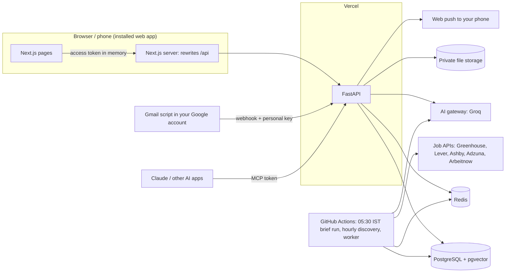

# NxtRole roadmap

Status: **baseline accepted by the founder (D-001)** · Prepared 27 Nov 2026 · Updated after Phase 0 on 27 Nov 2026
(what changed is listed under "Changes to phases from the Phase 0 decisions" in section E and in section I)

This file answers the ten sections the founder asked for (A to J). The copy-paste prompts for each
phase are in `docs/prompts/`. Permanent rules for Claude Code are in `CLAUDE.md`.

---

## A. Product understanding

**One line.** NxtRole is a personal AI job-search agent for India: every morning it shows the few real,
safe, well-matched jobs worth applying to, and helps you apply well and follow up, without ever
acting behind your back.

**Who it is for**
- Primary user: you, a job seeker in India aiming at full-stack and GenAI engineering roles.
- Later (after launch, if you choose): a small group of invited job seekers. The design keeps a
  `user_id` on every record from day one, so this is a later switch, not a rewrite.

**Problems it solves**
| Problem | What NxtRole does |
|---|---|
| Too many jobs, most irrelevant | Your rules filter first, then AI scores only the best 30 a day |
| Ghost jobs and scams | Trust check on every job (fees, WhatsApp-only, reposts, fake domains) |
| Late applications get ignored | Hourly checks of company job boards and alerts within the hour |
| Tailoring takes 30+ minutes | Application pack drafted from your true facts, checked, you approve |
| Silence after applying | Follow-up drafts on day 7 and 14, "likely ghosted" on day 21 |
| Interview prep is scattered | Company brief with sources, likely questions, mock interview, interview log |
| Indian offers are confusing | CTC to monthly in-hand, risky clauses explained |
| No idea what works | Weekly coach from your own numbers |

**Core user journeys**
1. Set up: sign in → upload resume → approve profile facts → set what you want → choose sources → alerts.
2. Morning: open Today → see top 5 matches with trust badges → open one → see fit with quotes.
3. Apply: make application pack → fill any blank → approve → open the company page → apply yourself → "I applied".
4. Track: Pipeline card moves (by you or from a job email, with undo) → rounds, notes, history.
5. Follow up: Follow-ups shows nudges due → copy draft → mark sent.
6. Prepare: interview booked → company brief + prep sections + mock interview → log the interview.
7. Decide: record offer → offer check → compare offers.
8. Improve: weekly coach → one change → confirm suggested rules in Sources and memory.
9. Ask: chat with your own data ("What should I do today?") with sources and approvals.

**MVP scope (the first release, Phases 0 to 16)**
- In: everything in the mocks, except the items marked "later" below and the changes in `docs/DECISIONS.md`
  (D-001 to D-023). This includes the Google Calendar connection (D-023).
- Later (after v1.0): public sign-up and billing, jobs abroad and visa filters (D-006), Telegram alerts and
  email alerts (D-011), browser extension and phone share sheet (D-007), voice (spoken mock interview and
  microphone, D-008), `.docx` export and in-browser LaTeX (D-009), multiple languages, native mobile apps.
- Never: auto-apply, sending messages for you, scraping logged-in sites.

**Success measures**
- About 5 strong matches each morning; fresh jobs alerted within about an hour of posting.
- 0 invented facts in tailored text; scoring agrees with your own labels at least 85% of the time.
- Today loads in under 2 seconds on a phone; the morning run finishes before 7:00 AM IST.
- Your reply rate is tracked and visible in the weekly coach.

---

## B. Latest UI mock analysis

- **Latest version:** the canvas "NxtRole UI Mocks · End product" (24 Nov 2026), exported to
  `docs/mocks/source/`: 23 desktop artboards and 23 phone artboards, light and dark themes.
- **Older version:** the PNG exports in `docs/mocks/desktop` and `docs/mocks/phone` (5 Nov 2026).
  They miss 9 newer screens and the trust badges on Today. The source files replace them.
- **Design language:** warm paper background, ink text, one blue accent, red only for "due today or
  tomorrow" and errors; Geist for text and headings, Geist Mono for labels and numbers; 1180 px content
  width, 260 px side navigation on desktop, bottom tab bar on phone; 12 px panel radius.
- **Screens:** 22 screens plus shared navigation, top bar, tab bar and a design foundations board.
  The full map of screen → route → phase is in `docs/mocks/MOCK_INVENTORY.md`.
- **Conflicts and gaps found:** 22, listed as M1 to M22 in the inventory (Phase 0 found M12 to M22). All of them
  are decided: see `docs/DECISIONS.md` and the "Known conflicts and gaps, with decisions" table in the inventory.

---

## C. Recommended technology stack

The stack was chosen for: free hosting for one user, strong AI tooling, privacy, and skills that
count on a full-stack AI engineer's resume. Every choice below has a cheaper or simpler alternative
that was considered.

| Layer | Choice | Why (in plain words) | Considered instead |
|---|---|---|---|
| Web app | Next.js 16 + React + TypeScript | One framework for pages, routing and a safe proxy to the API; huge community; types catch mistakes early | Plain React (more setup), Remix |
| Styling | Tailwind CSS v4 + the mock's design tokens | Turns the mock's colours and spacing into reusable classes; light/dark from one file | Plain CSS (slower to keep consistent) |
| UI parts | shadcn/ui (Radix) | Accessible dialogs, menus and tabs we restyle to match the mocks; the code lives in our repo | Building them by hand (accessibility risk) |
| Forms | React Hook Form + zod | Fast forms with clear validation messages | Formik |
| Server data | TanStack Query | Caching, loading and error states, undo-friendly updates | Fetching by hand |
| API | Python 3.13 + FastAPI | The best AI libraries are in Python; FastAPI checks every request with types and writes API docs itself | Node.js API (weaker AI tooling) |
| Database | PostgreSQL + pgvector | One database for data and "meaning search" (vectors); transactions keep data consistent | A separate vector database (more to run) |
| ORM and migrations | SQLAlchemy 2 + Alembic | Typed queries; every database change is a versioned file | Raw SQL |
| Auth | Our own JWT: email + password (Argon2), 15-min access token, rotating refresh cookie | No third-party login; full control; a strong interview topic | Supabase Auth, Clerk (less learning, vendor lock-in) |
| Queue, cache, limits | A `background_jobs` table in PostgreSQL + a small worker; Redis only for locks and rate limits (D-026; arq dropped: maintenance-only) | Jobs survive restarts and are visible in the database; Redis keeps runs from overlapping | arq, Celery |
| AI access | Our own thin gateway on Groq's official client + Instructor (D-025; LiteLLM dropped after two 2026 supply-chain compromises) | One door for every AI call: removes identity, walks the model chain, validates typed answers | LiteLLM |
| Models | gpt-oss-120b on Groq (main), other free Groq models in a chain, Llama 3.3 70B judge, small Llama for small tasks; Cerebras optional and off (D-024: its free tier is now a card-backed trial) | Strong free tier; providers that don't train on your data by default (verify in their settings) | Gemini/Mistral free tiers (rejected: may train on prompts) |
| Embeddings | fastembed `bge-small-en-v1.5` | Runs locally for free; your resume never leaves the server for this step | Paid embedding APIs |
| Agents | LangGraph | Multi-step agents that can pause for your approval and resume safely | Hand-written loops |
| Tools for other AI apps | MCP server | Lets Claude and other apps read your NxtRole data with a token you control | None |
| Tests | pytest, Vitest, Testing Library, Playwright, axe | Unit, component, end-to-end and accessibility tests | Fewer layers (more bugs) |
| Errors and AI tracing | Sentry, Langfuse (both free tiers, off until keys exist) | See crashes and every AI call's cost and quality | Logs only |
| Hosting (MVP) | Vercel (web + API), Supabase (Postgres + storage), Upstash (Redis), GitHub Actions (schedules and worker) | All free for one user, no credit card, HTTPS included, no domain to buy | A paid server (Railway, Render, Cloud Run) once there are real users |

Trade-off you should know: two languages (TypeScript and Python) is more to learn than one. It is
worth it because the AI work is much stronger in Python, and both are on most AI-engineer job posts.

---

## D. Proposed system architecture

**Main flow, the morning brief (the run starts at 05:30 IST = 00:00 UTC and finishes before 07:00 IST; the push goes at 07:00 IST = 01:30 UTC, D-030):**
1. GitHub Actions starts the worker and takes a Redis lock, so two runs can never overlap.
2. The worker fetches every source in parallel, with timeouts and retries.
3. Jobs are cleaned (Indian salary formats, city names), de-duplicated and saved. Closed jobs are marked.
4. The trust check runs (rules in code, AI only for "vague description").
5. Your confirmed rules filter the jobs; local embeddings rank the rest; the top 30 go to the AI.
6. The AI scores each job twice with three quoted reasons; code checks every quote is real.
7. Application packs are pre-drafted for the top 3 high-trust jobs (Phase 10 onwards).
8. Today is saved; one push alert is sent; the lock is released; run stats are logged.

**Request flow, signing in:** login form → `/api/auth/login` (through the Next.js proxy) → FastAPI
checks the password hash → returns a 15-minute access token (kept in memory) and sets a 7-day refresh
cookie (httpOnly, only sent to `/api/auth`) → every later call sends the access token → when it
expires, the app makes one refresh call and retries.

**Main data:** users, sessions (refresh tokens), profile versions (facts), files, companies, sources,
jobs, trust checks, scores, rules, applications, rounds, notes, offers, follow-ups, proposals, history
events, agent runs, notifications, MCP tokens. Full design in `docs/DATABASE_SCHEMA.md` (Phase 1).

---

## E. Phase-wise development roadmap

| Phase | Name | Main result | Depends on | Accounts or keys needed |
|---|---|---|---|---|
| 0 | Product discovery and PRD | PRD, MVP scope, decisions on open questions | – | none |
| 1 | Technical architecture | Architecture, schema, API and design-system documents | 0 | none |
| 2 | Project foundation | Repo structure, local Docker database, config, quality tools, CI, first tests | 1 | none |
| 3 | Design system and app shell | Tokens, components, navigation, every screen's empty/loading/error state, landing page | 2 | none |
| 4 | Backend core and authentication | Database base, API conventions, secure login, proposals + history + undo | 3 | none |
| 5 | AI gateway, resume and profile | Safe AI layer, resume upload, profile facts you approve, preferences | 4 | free Groq key |
| 6 | Jobs engine and trust check | Job sources, clean-up, duplicates, trust check, Jobs screen, add a job | 5 | free Adzuna key |
| 7 | Matching, memory and evals | Embeddings, hybrid search, rules memory, scoring with quotes, evals | 6 | (Groq) |
| 8 | Background work, Today and alerts | Worker, schedules, locks, Today brief, fresh-job radar, push alerts | 7 | none (push keys made locally) |
| 9 | Pipeline, follow-ups, offers and coach | Pipeline with undo, follow-ups, offer check, progress and coach | 8 | none |
| 10 | Agents: packs, research, studio, resume, prepare | LangGraph agents with approval, Studio, resume builder, interview prep | 9 | none |
| 11 | Ask NxtRole, notes, network and MCP | Chat agent, notes with sources, referral finder, MCP server | 10 | none |
| 12 | Integrations and observability | Gmail script webhook, Google Calendar connection, Sentry, Langfuse, full health checks | 11 | Google Cloud OAuth client (D-023); free Sentry and Langfuse (optional) |
| 13 | Quality assurance | Full end-to-end, visual, cross-browser, accessibility, performance tests | 12 | none |
| 14 | Security and performance hardening | Security review, privacy tools, load test, fixes | 13 | none |
| 15 | Production preparation | Production accounts, deploy pipeline, backups, monitoring, runbook | 14 | Supabase, Upstash, Vercel, GitHub secrets |
| 16 | Launch and maintenance | Deploy, smoke test, first real run, monitoring, maintenance routine | 15 | – |

Why this order: documents before code; the look and the login before features; each feature phase
delivers a whole slice (database → API → screen → tests) so nothing is built on fake data.
The template phase "Integrations" is split: job APIs arrive in Phase 6 where they are needed;
the remaining integrations come in Phase 12.

### Changes from Phase 1 (27 Nov 2026)

Phase 1 verified the stack against official sources (`docs/TECH_STACK.md`) and changed the plan in these places. The phase list is unchanged.

| Phase | Change | Decision |
|---|---|---|
| 2 | Docker Engine in Ubuntu on WSL 2 (not Docker Desktop); local Postgres + pgvector and Redis; pnpm and uv lockfiles with the 7-day rule; TypeScript 5.9 and ESLint 9 | D-036, D-041, D-042, D-044 |
| 4 | `create-owner` command, one-time recovery code, `/login/recover`; row-level security and the cross-user test harness; the `background_jobs` table | D-027, D-039, D-026 |
| 5 | Own AI gateway (no LiteLLM); Groq only with a model chain; token budget and pacing; signed direct-to-storage upload; switch on Groq zero data retention | D-024, D-025, D-029, D-033 |
| 8 | Worker is a Postgres queue, not arq; schedules from D-030 and D-040 (morning run 00:00 UTC, hourly discovery 07:00 to 21:00 IST, AI retries at each run) | D-026, D-030, D-040 |
| 10, 11 | Agents keep state in the PostgreSQL checkpointer; the Ask data tool uses a separate read-only role; short polling is the default for progress | D-038, D-039 |
| 12 | Calendar scope `calendar.events.owned`, testing-mode token expiry handled as "Reconnect"; webhook HMAC key encrypted at rest | D-031, D-035 |
| 15 | Free-tier checks: Supabase pause, Upstash commands, Actions minutes, Vercel function limits re-read live | D-030, D-038, D-040 |

### Changes to phases from the Phase 0 decisions (27 Nov 2026)

The phase list above is unchanged. Decisions D-001 to D-023 (`docs/DECISIONS.md`) change what some phases contain:

| Phase | Change | Decision |
|---|---|---|
| 1 | Also verify: Groq and Cerebras data terms and the "zero data retention" claim; the GitHub Actions free minutes for the hourly schedule; the hosting request-size limit against a 5 MB resume upload; the least-privilege Google Calendar scope; how the first owner account is created and how access is recovered without email; the start time of the morning run so the brief is ready by 7:00 AM IST; the resume PDF parser; the design of the read-only data tool. | D-003, D-010, D-012, D-013, D-023 |
| 3 | Adds: a sample sheet of loading, empty, error and offline states for approval; the desktop Fresh block; the Prepare list; Terms, Privacy, About, 404, offline, Export and Delete pages; tablet breakpoints; one nine-section Settings menu; the copy changes in PRD Appendix D. The 3D landing tour is the last, optional item. | D-014 to D-018, D-022 |
| 4 | Email and password only (no Google, no email code); one-time owner setup and no public sign-up; a recovery method; the Accounts section (sessions, change password). | D-003, D-010 |
| 5 | Groq only, with a chain of Groq models and our own gateway (no LiteLLM); Cerebras adapter optional and off; identity removed on every AI call; token budget and pacing. | D-012, D-024, D-025, D-033 |
| 6 | Official APIs and company feeds only; Add a job fetches public https careers or ATS pages only (SSRF guard) and sends login-only links to the by-hand form; India and Remote (India) only. | D-005, D-006, D-007 |
| 8 | Web push only (no Telegram, no email); schedules and alert rules from D-013; the company radar reads hiring signals, not funding news; the desktop Fresh block gets its data. | D-011, D-013, D-021 |
| 9 | Pipeline shows the "Moved by Gmail" banner and tag; the rules that move cards arrive in Phase 12. | D-004 |
| 10 | No voice in the mock interview; exports are `.tex` and PDF; Llama 3.3 70B reviews resume text; the Prepare list; Studio wording ("Approve", "Remind me at ..."). | D-008, D-009, D-012, D-017, D-022 |
| 11 | No microphone in Ask; notes live inside Pipeline cards; the read-only data tool uses a restricted database role; MCP token prefix `nxr_live_`. | D-008, D-017, D-019 |
| 12 | Gmail script `nxtrole-gmail.gs`; code rules that auto-move clear rejections and interview invites with undo; Google Calendar connection with OAuth (a Google Cloud project and OAuth client are created in this phase). | D-004, D-019, D-020, D-023 |

---

## F. Copy-paste execution prompts

One file per phase in `docs/prompts/`. Each has the 15 parts you asked for.

| Phase | File |
|---|---|
| 0 | `docs/prompts/PHASE-00-discovery.md` |
| 1 | `docs/prompts/PHASE-01-architecture.md` |
| 2 | `docs/prompts/PHASE-02-foundation.md` |
| 3 | `docs/prompts/PHASE-03-design-system-and-shell.md` |
| 4 | `docs/prompts/PHASE-04-backend-core-and-auth.md` |
| 5 | `docs/prompts/PHASE-05-ai-gateway-and-profile.md` |
| 6 | `docs/prompts/PHASE-06-jobs-engine-and-trust.md` |
| 7 | `docs/prompts/PHASE-07-matching-memory-evals.md` |
| 8 | `docs/prompts/PHASE-08-worker-today-alerts.md` |
| 9 | `docs/prompts/PHASE-09-pipeline-followups-offers-coach.md` |
| 10 | `docs/prompts/PHASE-10-agents-studio-resume-prepare.md` |
| 11 | `docs/prompts/PHASE-11-ask-notes-network-mcp.md` |
| 12 | `docs/prompts/PHASE-12-integrations-observability.md` |
| 13 | `docs/prompts/PHASE-13-quality-assurance.md` |
| 14 | `docs/prompts/PHASE-14-security-performance.md` |
| 15 | `docs/prompts/PHASE-15-production-preparation.md` |
| 16 | `docs/prompts/PHASE-16-launch-maintenance.md` |

How to run one: open the project folder in VS Code, start Claude Code, and paste the whole file's
contents, or type `Read docs/prompts/PHASE-02-foundation.md and follow it.` Claude Code reads
`CLAUDE.md` by itself.

---

## G. Testing, security and edge-case strategy

**Testing layers**
| Layer | Tool | What it proves | When |
|---|---|---|---|
| Unit | pytest, Vitest | Small functions: salary parsing, trust rules, token rotation, quote check | Every task |
| Integration | pytest + real Postgres and Redis in Docker | API + database together, including failures | Every API task |
| Component | Vitest + Testing Library | Each screen part's states and accessibility | Every UI task |
| End-to-end | Playwright (Chromium, Firefox, WebKit; desktop and phone sizes) | Whole journeys as a user | End of each feature phase, full suite in Phase 13 |
| Visual | Playwright screenshots compared with the mocks | Screens still match the design | Phase 3 onwards |
| Accessibility | axe in Playwright, keyboard-only runs | WCAG 2.2 AA basics | Every UI phase |
| AI evals | pytest sets built from your own labelled jobs | Scoring ≥ 85% agreement, 0 invented facts, Q&A ≥ 90%, tool choice ≥ 18/20 | Phases 7, 10, 11; in CI from Phase 13 |
| Performance | Lighthouse, a small load test | Today < 2 s on phone; API fast under load | Phases 13 and 14 |

Tests use recorded real responses (with source and date in the file name), never invented ones.

**Security approach:** threat model in Phase 1; secure-by-default code in every phase (validation,
user scoping, no HTML rendering, secrets in env); a full review in Phase 14 covering OWASP Top 10 and
the OWASP Top 10 for LLM apps (prompt injection, data leakage, excessive agency).

**Edge-case register:** `docs/TESTING.md` lists every edge case with the test that covers it. Each
phase prompt names the cases for that phase. Product-specific examples: reposted jobs, the same job on
three sites, salary in LPA/monthly/USD, Bangalore vs Bengaluru, scam posts, prompt-injection text in
a job post, all AI providers rate-limited, two tabs refreshing a session, undo after later changes,
morning run overlapping, free database pausing.

---

## H. Production-readiness checklist

- [ ] All phase acceptance criteria accepted by you
- [ ] Full test suite, evals and accessibility checks green in CI
- [ ] Security review done; no critical or high issues open; dependencies audited
- [ ] Production accounts created; `check-config` passes every line
- [ ] Database migrations run on production; pgvector enabled; Data API off
- [ ] Secrets only in Vercel and GitHub secrets; nothing in git
- [ ] HTTPS on the `vercel.app` address; security headers set
- [ ] Error tracking (Sentry) and AI tracing (Langfuse) receiving events
- [ ] Daily backup runs; one restore tested
- [ ] Runbook and rollback steps written and tried once
- [ ] Smoke test of every core journey on desktop and phone
- [ ] Privacy notice in the app; "export my data" and "delete my data" work

---

## I. Risks, assumptions and open questions

**Assumptions (change any of them by telling me)**
1. You are the only user at launch; the code is ready for invited users later.
2. Hosting stays on free tiers; no domain is bought (the app lives at a `vercel.app` address).
3. Nothing in the existing repository needs to be kept except `docs/` (confirmed in Phase 0, D-002).
4. Claude Code runs on your Windows laptop with Node.js, pnpm, uv, and Docker Engine inside Ubuntu on WSL 2 (installed in Phase 2, D-041).

**Risks**
| Risk | Impact | Plan |
|---|---|---|
| Free AI limits change or run out | Scoring stops for the day | Fallback chain, "AI score pending" state, quotas shown in Settings |
| Vercel's free plan is for non-commercial use | Must upgrade if NxtRole earns money | Fine for a personal tool; revisit before charging anyone |
| Job sources change their APIs or terms | A source stops working | One adapter per source, source health in Settings, recorded tests |
| Free Supabase database pauses when unused | Morning run fails | The daily run itself keeps it active; health alert if it fails |
| LaTeX compiling is heavy to host | Resume PDF export | Decision in Phase 10 (see M6) |
| Two languages for a beginner | Slower learning | Teaching notes per task; learning log |
| Personal data in a cloud app | Privacy harm if leaked | Identity removed before AI, encryption in transit, minimal logs, delete-my-data |
| India's DPDP Act applies once other people's data is stored | Legal duties for invited users | Privacy notice, consent and deletion before inviting anyone |

**Questions answered in Phase 0** (all recorded in `docs/DECISIONS.md`)

| # | Question | Answer | Record |
|---|---|---|---|
| 1 | Only you at launch, or other users too? | Only you, built ready for invites | D-003 |
| 2 | Change the login screen to email + password? | Yes: no Google, no email code | D-010 |
| 3 | Get free keys only when a phase needs them? | Yes (plus a Google Cloud OAuth client in Phase 12) | D-020, D-023 |
| 4 | Alerts: phone push first? | Yes: Telegram later, no email alerts in v1 | D-011 |
| 5 | Remove Mistral, Gemini and OpenRouter? | Yes; later narrowed to Groq only (Cerebras needs a card) | D-012, D-024 |
| 6 | Tablet rule | Yes: phone layout below 768 px, desktop from 768 px, icon-only side menu below 1024 px | D-014 |
| 7 | Missing empty, loading and error states | Designed in the mock style and shown to you first | D-015 |
| 8 | Resume export | `.tex` + PDF from HTML; `.docx` and in-browser LaTeX later | D-009 |
| 9 | Voice mock interview | Text only in v1; voice later (changed from "Chrome voice as an extra") | D-008 |
| 10 | Desktop fresh jobs | A block at the top of Today | D-016 |
| 11 | Existing code from earlier runs | None exists; start clean | D-002 |
| 12 | Old `BUILD-PROMPT.md` | Does not exist; nothing to move | D-002 |
| 13 | Gmail moving cards | Auto-move clear rejections and interview invites with undo; propose the rest | D-004 |

Phase 0 found 11 more conflicts and gaps (M12 to M22). Their decisions are D-005 to D-023 (see `docs/mocks/MOCK_INVENTORY.md`).

---

## J. Recommended execution order

1. Copy this pack into your repository (see `START-HERE.md`). Move `BUILD-PROMPT.md` to `docs/archive/` if you have it
   (it was not in the repository when Phase 0 ran, D-002).
2. Answer the open questions in section I (one at a time in chat is fine).
3. Run Phase 0 in Claude Code. Read its report. Approve or ask for changes.
4. Run Phases 1 → 16 in order, one at a time. After each: read the completion report, try the
   acceptance checks yourself, then approve, ask for fixes, or approve a commit.
5. Rough size: Phases 0–1 are documents (small); 2–4 are foundations (medium); 5–11 are features
   (large, the core of the product); 12–14 harden it (medium); 15–16 launch it (medium, with you).
6. Never skip a phase. If a phase grows too big, ask Claude Code to split it into parts with a clean
   stopping point after each.
